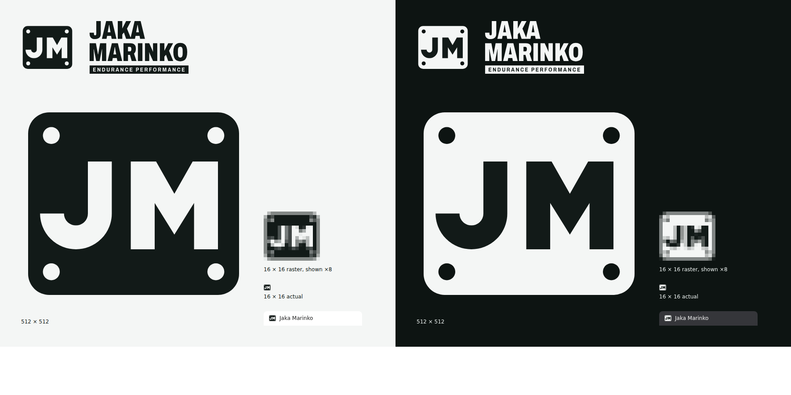
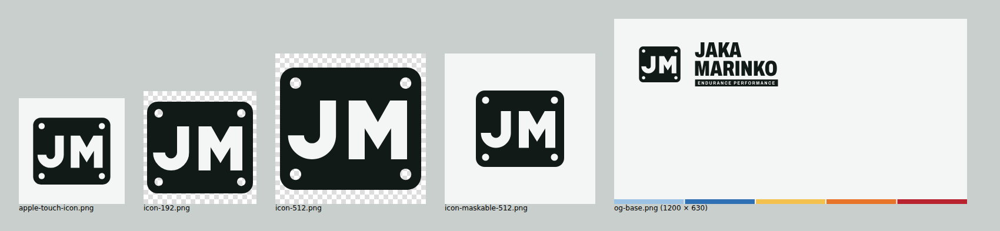

# Brand: Jaka Marinko — Endurance Performance

The rules on one page. Live examples of everything: `/en/styleguide` (hidden from search engines). Code: `apps/web/src/styles/` (tokens, fonts), `apps/web/src/components/brand/` (components).

**Feel:** serious endurance sport and lab science. Precise, calm, fast, credible. Nothing from the old Lovable site.

## Logo
**The race bib.** The mark is a race number with four safety-pin holes and "JM": the object every endurance racer pins on. The wordmark is "JAKA / MARINKO" stacked in condensed heavy Archivo, with "ENDURANCE PERFORMANCE" knocked out of a strip exactly as wide as "MARINKO", like the line printed under a bib number.

- **Lockup:** the mark is as tall as the wordmark, with 30 % of that height between them. The sub-line is part of the name and stays in English in both languages.
- **Mark alone** for favicons, app icons, avatars and the app bar on phones. It's built on a 32-unit grid (2 units per pixel at 16 px) and stays legible at 16 × 16; the pin holes may blur there, the "JM" doesn't.
- **Colours:** one colour only. Graphite (`#121A18`) on light backgrounds, firn (`#F4F6F5`) on dark. The letters and the sub-line are cut out of the bib and the strip. Never orange, green or a gradient; never on a busy photo.
- **Clear space:** at least half the mark's height on every side. **Minimum size:** full logo 32 px tall, mark 16 px.
- Don't stretch, rotate, outline, add shadows, retype the name in a live font, or rearrange the lines.

**In code:** the `Logo` component (`variant="full" | "mark"`, size it with `h-*`). It uses theme tokens, so it flips with dark mode. The wordmark is outlined, so it never waits for the web font.

**Files** in `apps/web/public/brand/` (`-light` = for light backgrounds, `-dark` = for dark backgrounds):

| File | Use |
|---|---|
| `logo-light.svg`, `logo-dark.svg` | full lockup (mark + wordmark) |
| `wordmark-light.svg`, `wordmark-dark.svg` | name only, where the mark is already shown nearby |
| `mark-light.svg`, `mark-dark.svg` | mark alone |
| `icon.svg` | browser favicon; switches with the browser's light/dark setting |
| `icons/favicon.ico` | 16, 32 and 48 px for older browsers |
| `icons/apple-touch-icon.png` | 180 px, on firn |
| `icons/icon-192.png`, `icons/icon-512.png`, `icons/icon-maskable-512.png` | PWA (`site.webmanifest`); the maskable one keeps the mark inside the safe zone |
| `og-base.png` | 1200 × 630 Open Graph base: logo top left, zone colours along the bottom, free space for a page title |

The wordmark outlines (`components/brand/wordmark-paths.ts` and the SVGs) were made from Archivo's variable font with kerning: name at width 70 / weight 850, sub-line at width 85 / weight 700, tracked to fill the strip. To change them, re-outline from the font; never edit the path data by hand.

## Colour
Tokens live in `apps/web/src/styles/theme.css` (light on `:root`, dark on `.dark`). Use Tailwind names (`bg-primary`, `text-muted-foreground`), never raw hex in components.

| Role | Light | Dark | Use |
|---|---|---|---|
| Background "firn" | `#F4F6F5` | `#0D1412` | pages |
| Foreground "graphite" | `#121A18` | `#E8EEEC` | text |
| Primary "spruce" | `#15493F` | `#5CC2A8` | buttons, links, the logo |
| Signal | `#E8542A` | `#F26A41` | the one thing that matters on a screen: a dot, a tick, a marker. Never large areas, never body text. |
| Destructive | `#B42318` | `#F97066` | cancel, delete, errors |

- **Signal is used once per view** (the section eyebrow dot, a stat's tick, the threshold point). If everything is orange, nothing is.
- **Contrast:** every text/background pair meets WCAG AA (4.5:1). `src/styles/theme.test.ts` checks it on every `pnpm test`; add your pair to `textPairs` in `tokens.ts` when you introduce a new one.
- **Training zones** `zone-1`…`zone-5` (recovery, endurance, tempo, threshold, VO₂max) go cool to hot with falling lightness, so they stay apart with red-green colour blindness (tested under simulated deuteranopia). Always label zones with their number (Z1–Z5), never colour alone. Text on a zone uses `zone-N-foreground`.
- **Charts** use `chart-1`…`chart-5` in that order; also tested for deuteranopia.

## Type
- **Archivo** for everything, using its width axis as hierarchy: expanded (`font-stretch-expanded`) and bold/extra-bold for headings and big numbers, normal width for text. Slovenian letters (č, š, ž) included.
- **Martian Mono** only for small labels, units and eyebrows (`font-mono`, uppercase, wide tracking). Never for sentences.
- **Numbers that get compared** (times, paces, heart rates, lab values, prices) use `tabular-nums` so columns line up and live values don't jitter.
- Both fonts are self-hosted by `next/font` with matched fallbacks: no layout shift (Lighthouse CLS 0 on the styleguide).
- Sentence case everywhere except eyebrows and the logo.

## Components
| Component | Use |
|---|---|
| `Logo` | header, footer, emails (as image later) |
| `SectionHeading` | eyebrow + title + lead at the top of a section |
| `StatBlock` | one measured number with unit and label (80 ml/kg/min, VO₂max) |
| `ZoneBar` | a person's five zones as a bar + legend |
| `PriceCard` | a test or package with its price; pass the price formatted for the locale |
| `PhotoFrame` | every athlete photo |

shadcn primitives in `components/ui/` take the brand from the tokens; don't restyle them per page.

## Photos
The photos we have (`apps/web/public/brand/photos/`) are small (460–1200 px on the short side).
- Show them at most 384 px wide (`PhotoFrame` default). **Never full-bleed, never as a hero background.**
- Portrait 4:5 by default; square or 3:2 when the layout needs it. Set `position` so faces aren't cut.
- When several photos sit together, use `treatment="tinted"` (spruce tint): it hides compression and mixed colour casts. A single photo can stay natural.
- Always a caption naming the race or discipline, and a real `alt`.
- Larger uses wait for the full-resolution originals (see `docs/content/`).

## Tone of voice
Like a good coach after a test: specific, calm, direct. Short sentences, numbers over adjectives, "you" (EN) / "ti" (SL, informal, as Jaka writes).

| Do | Don't |
|---|---|
| "Your LT2 is 176 bpm. Threshold intervals sit just below it." | "Unlock your ultimate potential!" |
| "Results are in your account within minutes." | "Lightning-fast AI-powered results" |
| "Book a test" / "Rezerviraj meritev" | "Submit" / "Pošlji" |

- Never mention AI, models or automation to customers. Say "your plan", "your analysis", "your report" / "tvoj načrt", "tvoja analiza", "tvoje poročilo". Never claim the opposite either ("handwritten").
- Promise personal work from Jaka only where the package includes it.
- Slovenian is written natively, not translated word for word. Use the terms from the glossary in `docs/coaching-method.md` (e.g. "trening cone", "laktatni profil", "pražna cona").
- Health words stay plain and non-alarming; red-flag messages are fixed texts, not tone experiments.
